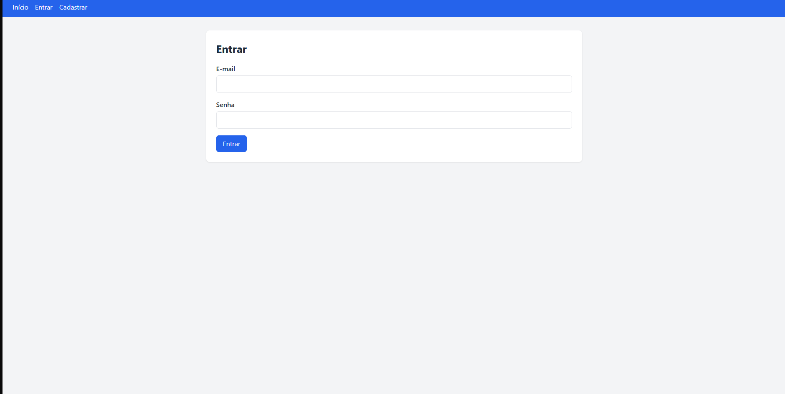
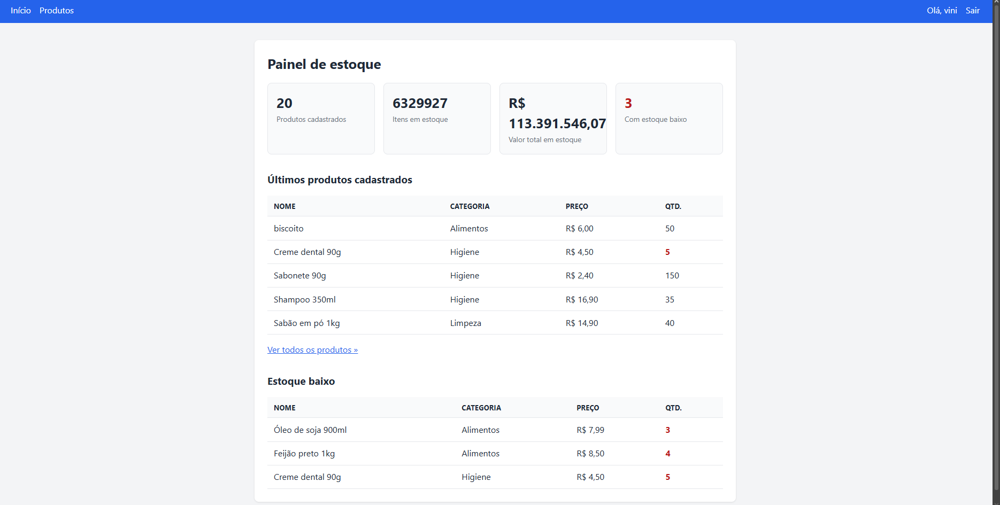
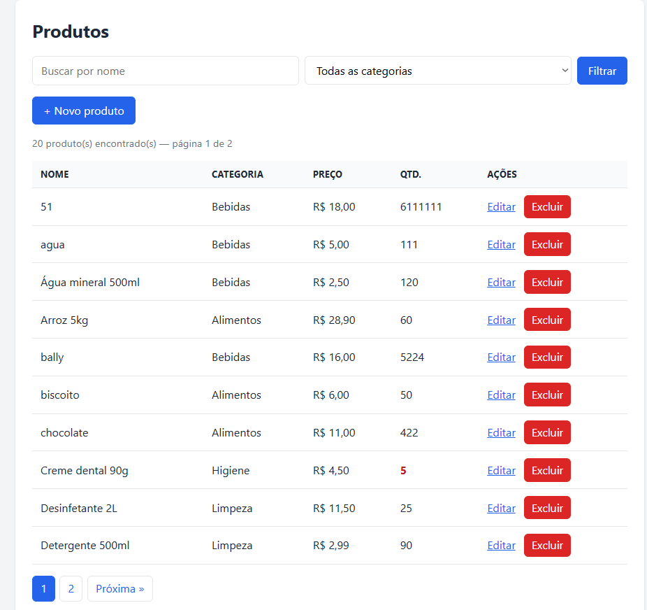
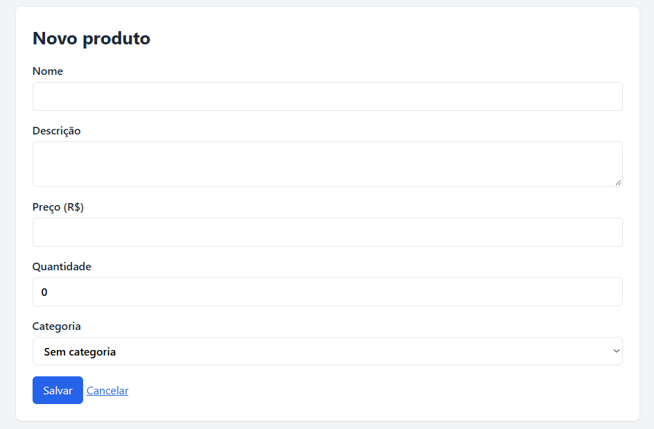
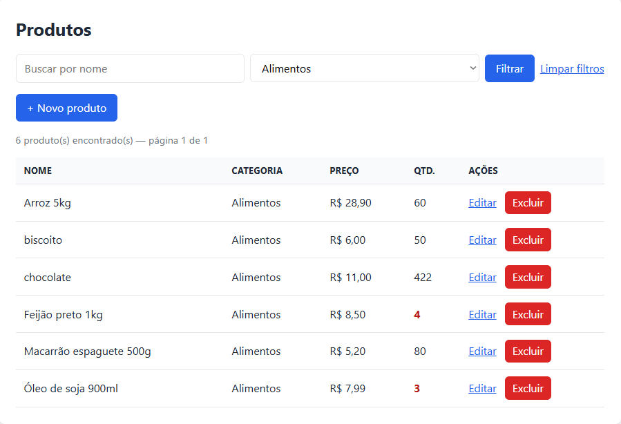

# 📦 Sistema de Controle de Estoque

Aplicação web de controle de estoque desenvolvida com **PHP, MySQL e PDO**, com login de usuários, cadastro de produtos e categorias, busca com filtros, paginação e um painel com resumo do estoque.

Projeto de portfólio criado durante o curso de Análise e Desenvolvimento de Sistemas, com foco em boas práticas básicas de segurança e organização de código.

## 📸 Capturas de tela

> Os arquivos abaixo ficam na pasta `docs/`. Ajuste os nomes caso suas imagens tenham nomes diferentes.

| Login | Painel |
|---|---|
|  |  |

| Listagem com filtros e paginação | Formulário de produto |
|---|---|
|  |  |
**Busca e filtro por categoria, com alerta de estoque baixo**



## ✨ Funcionalidades

- **Autenticação:** cadastro, login e logout, com senhas protegidas por hash.
- **Páginas protegidas:** só usuários logados acessam o sistema.
- **CRUD de produtos:** criar, listar, editar e excluir, com validação dos dados.
- **Categorias:** cada produto pertence a uma categoria (relacionamento entre tabelas).
- **Busca e filtros:** busca por nome e filtro por categoria, que podem ser combinados.
- **Paginação:** 10 produtos por página, mantendo os filtros ativos.
- **Painel (dashboard):** total de produtos, itens em estoque, valor total, alerta de estoque baixo, últimos produtos cadastrados.
- **Layout responsivo:** funciona em computador e celular.

## 🛠️ Tecnologias

- PHP 8 (com PDO)
- MySQL
- HTML5 e CSS3 (variáveis CSS, grid, flexbox, media queries)
- Apache (via XAMPP)
- Git e GitHub

## 🗂️ Estrutura do projeto

```
estoque/
├── assets/
│   └── style.css            # Estilos do sistema
├── auth/
│   ├── cadastro.php         # Criação de conta
│   ├── login.php            # Autenticação
│   └── logout.php           # Encerra a sessão
├── config/
│   └── conexao.php          # Conexão com o banco (PDO)
├── docs/                    # Capturas de tela usadas neste README
├── includes/
│   ├── auth.php             # Protege as páginas (exige login)
│   ├── funcoes.php          # Validação de produto e links de paginação
│   ├── header.php           # Cabeçalho e menu
│   ├── footer.php           # Rodapé
│   └── tabela_resumo.php    # Tabela reaproveitada no painel
├── produtos/
│   ├── _form.php            # Formulário usado em criar e editar
│   ├── criar.php
│   ├── editar.php
│   ├── excluir.php
│   └── listar.php           # Listagem com busca, filtro e paginação
├── banco.sql                # Script de criação do banco e das tabelas
└── index.php                # Painel
```

## 🚀 Como executar o projeto

**Pré-requisitos:** [XAMPP](https://www.apachefriends.org) (Apache, MySQL e PHP) instalado.

1. **Baixe o projeto** dentro da pasta `htdocs` do XAMPP:
   ```bash
   cd C:\xampp\htdocs
   git clone https://github.com/viniciusAbreu17/sistema-estoque-php.git estoque
   ```
2. **Inicie** o **Apache** e o **MySQL** no painel do XAMPP.
3. **Crie o banco de dados:** acesse `http://localhost/phpmyadmin`, abra a aba **SQL**, cole o conteúdo do arquivo `banco.sql` e clique em **Executar**.
4. **Confira a conexão** em `config/conexao.php`. O padrão do XAMPP já funciona:
   ```php
   $host = 'localhost';
   $banco = 'estoque';
   $usuario = 'root';
   $senha = '';
   ```
5. **Acesse** `http://localhost/estoque`, crie uma conta em **Cadastrar** e faça login.

> A pasta do projeto precisa se chamar `estoque`, pois os links do menu usam o caminho `/estoque/`.

## 🗄️ Banco de dados

Três tabelas:

| Tabela | Descrição |
|---|---|
| `usuarios` | `id`, `nome`, `email` (único), `senha` (hash), `criado_em` |
| `categorias` | `id`, `nome` (único) |
| `produtos` | `id`, `nome`, `descricao`, `preco`, `quantidade`, `categoria_id` (chave estrangeira para `categorias`), `criado_em` |

Se uma categoria for removida, os produtos dela ficam sem categoria (`ON DELETE SET NULL`).

## 🔍 Código explicado

### Conexão segura com PDO

A conexão usa PDO com tratamento de exceções e `FETCH_ASSOC` como padrão. O erro técnico não é exibido ao usuário.

```php
$pdo = new PDO(
    "mysql:host=$host;dbname=$banco;charset=utf8mb4",
    $usuario,
    $senha,
    [
        PDO::ATTR_ERRMODE => PDO::ERRMODE_EXCEPTION,
        PDO::ATTR_DEFAULT_FETCH_MODE => PDO::FETCH_ASSOC,
    ]
);
```

### Senhas com hash

Na criação da conta, a senha nunca é salva em texto puro:

```php
$hash = password_hash($senha, PASSWORD_DEFAULT);
```

No login, ela é conferida com `password_verify`, e o ID da sessão é renovado para evitar *session fixation*:

```php
if ($usuario && password_verify($senha, $usuario['senha'])) {
    session_regenerate_id(true);
    $_SESSION['usuario_id'] = $usuario['id'];
}
```

### Prevenção de SQL Injection

Todas as consultas com dados do usuário usam *prepared statements*. Os valores vão separados da consulta:

```php
$stmt = $pdo->prepare('SELECT id, nome, senha FROM usuarios WHERE email = ?');
$stmt->execute([$email]);
```

### Prevenção de XSS

Tudo que vem do usuário ou do banco é escapado antes de aparecer na página:

```php
<?= htmlspecialchars($p['nome']) ?>
```

### Proteção de páginas

O arquivo `includes/auth.php` é incluído no início de cada página restrita. Se não houver sessão ativa, o usuário é redirecionado para o login:

```php
if (!isset($_SESSION['usuario_id'])) {
    header('Location: /estoque/auth/login.php');
    exit;
}
```

### Busca, filtro e paginação

A consulta é montada dinamicamente, mas os valores sempre passam pelos parâmetros (`?`). Primeiro conta-se o total de resultados, depois busca-se apenas a página atual com `LIMIT` e `OFFSET`:

```php
$where = $condicoes ? ' WHERE ' . implode(' AND ', $condicoes) : '';

$stmtTotal = $pdo->prepare('SELECT COUNT(*) FROM produtos p' . $where);
$stmtTotal->execute($params);
$total = (int) $stmtTotal->fetchColumn();

$totalPaginas = max(1, (int) ceil($total / $porPagina));
$offset = ($pagina - 1) * $porPagina;
```

`LIMIT` e `OFFSET` recebem apenas inteiros calculados pelo próprio código, nunca texto digitado pelo usuário.

### Reaproveitamento de código

- `produtos/_form.php` é usado tanto em **criar** quanto em **editar**.
- `includes/funcoes.php` concentra a validação do produto.
- `includes/tabela_resumo.php` é reaproveitado nas duas listas do painel.

### Painel com consultas agregadas

O resumo usa `COUNT`, `SUM` e `COALESCE` direto no SQL:

```sql
SELECT COUNT(*) AS total_produtos,
       COALESCE(SUM(quantidade), 0) AS total_itens,
       COALESCE(SUM(preco * quantidade), 0) AS valor_estoque,
       COALESCE(SUM(quantidade <= 5), 0) AS estoque_baixo
FROM produtos;
```

## 🔭 Melhorias futuras

- [ ] Token CSRF nos formulários (especialmente na exclusão)
- [ ] Limite de estoque baixo configurável (hoje fixo em 5)
- [ ] CRUD de categorias pela interface
- [ ] Perfis de usuário (administrador e operador)
- [ ] Histórico de movimentações de estoque (entradas e saídas)
- [ ] Exportação da listagem para CSV

## 👤 Autor

**Vinicius Abreu Gondariz**
Estudante de Análise e Desenvolvimento de Sistemas — Universidade Veiga de Almeida
Rio de Janeiro, RJ

- GitHub: [viniciusAbreu17](https://github.com/viniciusAbreu17)
- LinkedIn: [vinicius-abreu-32b454359](https://www.linkedin.com/in/vinicius-abreu-32b454359)
